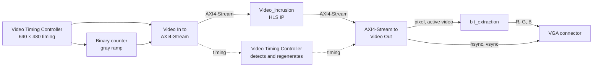
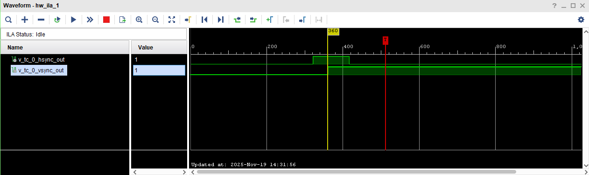

# ZedBoard VGA video pipeline

A real-time video chain on the ZedBoard's Zynq-7000 (XC7Z020), built as a Vivado block design. A gray test pattern made in hardware goes into AXI4-Stream, through a video processing IP written in C++ with Vitis HLS, and back out as 640 × 480 VGA. The processing IPs invert the image or draw a two-digit number on it. An Embedded Systems and Interfaces project at Polytech Dijon (2025–2026).

## The chain

| Block | Role |
|---|---|
| Clock Wizard | Makes 25.2 MHz for the pixels and 108 MHz for AXI4-Stream from the board's 100 MHz |
| Video Timing Controller | Generates the 640 × 480 sync, blanking and active video signals |
| Binary counter | Counts the pixels of each line during active video and restarts at each hsync: a horizontal gray ramp |
| Video In to AXI4-Stream | Turns pixels and timing into an AXI4-Stream (TUSER marks a frame's first pixel, TLAST a line's last) and crosses to 108 MHz |
| Video_incrusion | The HLS IP in the chain: draws a two-digit number at the top left of the image |
| Video Timing Controller | Detects the incoming timing and regenerates it for the output |
| AXI4-Stream to Video Out | Turns the stream back into pixels with hsync and vsync at 25.2 MHz |
| [bit_extraction](Video_Strem_Processing/source/bit_extraction.vhd) | Sends a pixel's 4 MSBs to R, G and B during active video and black during blanking |

The ZedBoard's VGA port has 4 bits per colour; the same 4 bits on all three make 16 grays.

## Processing IPs

| IP | Source | What it does |
|---|---|---|
| `Video_invert` | [VGA_Inverter/Hls_inverter.cpp](VGA_Inverter/Hls_inverter.cpp) | Each pixel becomes 255 − pixel when `enable` is 1 |
| `Video_incrusion` | [VGA_Incrust/Video_Incrust.cpp](VGA_Incrust/Video_Incrust.cpp) | Draws `binome`, 0 to 99, in a 5 × 7 font at (10, 10) when `enable` is 1 |
| `video_inverter` | [video_inverter.vhd](Video_Strem_Processing/Video_Strem_Processing.srcs/sources_1/video_inverter.vhd) | The inversion written by hand in VHDL, with one register stage; `VidOrig_nVideoInv` selects it |
| `AXI_inverter` | [Video_Inverter_V1/inverter.cpp](Video_Inverter_V1/inverter.cpp) | The first HLS version of the inverter, controlled over AXI-Lite |
| `Axis_Stream_invert` | [Axis_Inverter.cpp](Axis_Inverter.cpp) | An inverter for 24-bit RGB pixels |

`Video_invert` and `Video_incrusion` keep the stream's side channels and take one pixel per clock. They have no start signal and take their settings as plain input ports, for switches or constants.

## Files

| Path | Content |
|---|---|
| [Video_Strem_Processing/](Video_Strem_Processing/) | The Vivado 2022.2 project: the block design in `source/VGA_source_bd/`, the ZedBoard pins in `source/Base_line_top.xdc`, the VHDL and the testbenches |
| [VGA_Inverter/](VGA_Inverter/), [VGA_Incrust/](VGA_Incrust/) | Vitis HLS projects of the two IPs, with their C testbenches and the exported IPs in `export/` |
| [Video_Inverter_V1/](Video_Inverter_V1/), [Axis_Stream_Inverter/](Axis_Stream_Inverter/) | Vitis HLS projects of the earlier inverters |
| [Video_Stream_VGA.pdf](Video_Stream_VGA.pdf) | The report |

The Vitis HLS projects use the repository's root as their workspace.

## Building

1. Export the HLS IPs. From the repository's root, run `vitis_hls -f VGA_Incrust/solution1/script.tcl`, which synthesizes and exports the IP. Then replace `VGA_Incrust/export/` with the content of the exported zip. Do the same for `VGA_Inverter`.
2. Open `Video_Strem_Processing/Video_Strem_Processing.xpr` in Vivado 2022.2. Its IP repositories are the two `export/` folders.
3. In the block design, upgrade `Video_incrusion_0` (Reports > Report IP Status). Connect its new `enable` port to a constant 1 or a switch, and its `binome` port to an 8-bit constant with the number to draw.
4. Generate the bitstream, program the board and plug a monitor into the VGA port. The reset, active low, is switch SW0: set it to 1.

## Simulation

| Testbench | Checks |
|---|---|
| `tb_bit_extraction` | Self-checking: bit_extraction's output for several pixels, in active video and in blanking |
| `video_inverter_tb` | The VHDL inverter with inversion on, then off, to watch in the waveform |
| `tb_VGA_source_bd_wrapper` | The whole block design after a reset, until the simulation is stopped; a frame takes about 16.7 ms |

In Vitis HLS, C simulation of `VGA_Inverter`, `VGA_Incrust` and `Video_Inverter_V1` runs their testbenches, which check every pixel and print `PASS` or `FAIL`.

## Fixes since the report

- The HLS IPs took their start signal and settings over AXI-Lite, but the block design has no processor to drive them. Nothing started `Video_incrusion`, so the video stopped there. That explains the final test with no image, which the report put down to IP versions. Both IPs are now free-running. This has not been tested on the board yet: the `export/` folders still hold the old IPs until step 1 of Building is done.
- `tb_bit_extraction.vhd` had been overwritten by a stub file that Vivado generates; it has been written again from the report's figure 4.5.
- `tb_VGA_source_bd_wrapper` drove a 50 MHz clock into a clock wizard set up for 100 MHz.
- `Video_Inverter_V1`'s testbench called a function that does not exist and included a header that Vitis HLS no longer has.

The HLS code changes were checked by compiling the IPs and their testbenches with clang, with simple stand-ins for the HLS headers, and the VHDL testbenches with the open-source simulator nvc.

## Report

[Video_Stream_VGA.pdf](Video_Stream_VGA.pdf) covers video timing, the VGA chain, the AXI4-Stream pipeline, the VHDL and HLS processing IPs, ILA debugging and the problems met.

## Authors

Fonkoua Charle Luce Soriane and Mambo Motsou Junior Deogracias, supervised by Julien Dubois.
